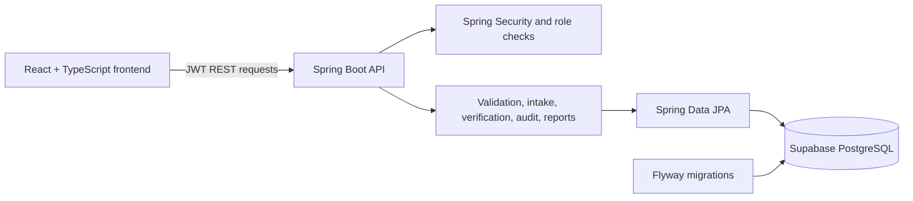

# APAAR GARUDA NETRA

Student admission data management and academic verification workflow prototype for AICTE approved institutions. The application provides institutional student records, CSV intake validation, intake analytics, audit trails, and consent based token verification.

> **Database status (31 October 2026):** This repository targets Supabase PostgreSQL project `hxmlezblzvdbacebsmcb`. Its `public` schema is currently empty in the Supabase dashboard. Flyway migrations have not been run there, and no database connection, CRUD, or persistence test against Supabase has passed. The ignored local `backend/.env` does not currently identify the approved project and must be corrected before database setup.

The APAAR verifier in this prototype uses a **simulated adapter** and synthetic sample data. It is not connected to an authorized government APAAR or DigiLocker API and does not claim official verification.

## Problem and objectives

Institutions manage student admission data in separate systems, making it difficult to identify inconsistent records, duplicate enrolments, and programme intake overages. GARUDA NETRA provides a shared workflow for validating institutional submissions and reviewing student record verification requests while limiting which roles can access records.

The project aims to:

- Validate student admission records and CSV uploads.
- Show institution and programme intake metrics using database records.
- Provide role protected review, reporting, and audit workflows.
- Support consent based, limited field credential checks using opaque tokens.
- Keep government identity integrations explicitly out of scope until authorized APIs are available.

## Implemented features

- **Institution workspace:** institution scoped student directory, student create/edit, CSV uploads, validation issue resolution, batch summaries, and institution statistics.
- **Regulator workspace:** cross institution intake metrics, programme utilization, anomaly review, alerts, CSV/PDF reports, and audit log views.
- **Credential verifier:** QR/token lookup with token expiry, consent checks, and permitted-field data minimization. The lookup uses the simulated adapter.
- **Verification requests:** submit, queue, reviewer decisions (`PENDING`, `UNDER_REVIEW`, `APPROVED`, `REJECTED`), mandatory rejection remarks, request history, in-app notifications, reviewer assignment, and priority metadata.
- **Student account onboarding:** students can register and sign in. An institution administrator must link an account to the matching institution record before the portal exposes academic details. Students can view their own linked record, submit a verification request, review request/notification history, and request changes to contact information.
- **Validation and audit:** server side validation, duplicate detection, student change history, login and workflow audit events, BCrypt password hashing, and JWT authentication.
- **Data tools:** paginated student search/filter, CSV import/export, and PDF/CSV summary reports.

The Student Portal and reviewer assignment changes are implemented locally with additive Flyway migration V4. They are not active against Supabase until that migration has been applied.

## Roles and access

| Role | Main access |
| --- | --- |
| `ROLE_INSTITUTION_ADMIN` | Students and uploads scoped to the assigned institution; verification request submission/queue; notifications; link a student account when emails match. |
| `ROLE_AICTE_REGULATOR` | Cross institution metrics, reports, anomalies, audit, and reviewer actions. |
| `ROLE_AUTHORIZED_VERIFIER` | Verification review queue, decisions, and in-app notifications. |
| `ROLE_VERIFICATION_OFFICER` | Verification review queue, decisions, and notifications. |
| `ROLE_SUPER_ADMIN` | Currently shares regulator API/dashboard access; a separate user/institution administration panel is not implemented. |
| `ROLE_STUDENT` | Own linked student profile, own verification requests, own notifications, and profile update requests. Unlinked accounts see an onboarding message only. |

Existing deployments may still contain the legacy roles `ROLE_AICTE_REGULATOR` and `ROLE_AUTHORIZED_VERIFIER`.

## Verification workflow

1. An institution administrator submits a student record, or a linked student submits their own record for review.
2. Duplicate active requests for the same student are rejected.
3. An authorized verifier or verification officer may set priority/assignee and record a decision.
4. Rejection requires a reason. Decisions and assignment actions are written to verification history/audit records and create in-app notifications.
5. Students can see their own request history and resubmit after a rejected request.

This workflow records application level review only; it does not verify an APAAR identity with a government service.

## System architecture



## Technology stack

| Layer | Technologies |
| --- | --- |
| Frontend | React 18, TypeScript, Vite, Tailwind CSS, React Router, Recharts, Axios, PapaParse |
| Backend | Java 17, Spring Boot 3, Spring Security, Spring Data JPA, Jakarta Validation, JWT |
| Database | Supabase PostgreSQL, JDBC, Flyway |
| Reports | OpenPDF, CSV export |
| Tests | JUnit 5, Spring test support, Vitest, React Testing Library |

## Repository layout

```text
backend/
  src/main/java/com/infobro/apaar/
    config/       JWT, security, connection guards
    controller/   REST API endpoints
    dto/          API request/response objects
    entity/       JPA entities
    repository/   Spring Data repositories
    service/      Application logic
  src/main/resources/db/migration/  Flyway migrations V1–V4
  src/test/java/                    Unit and integration tests
frontend/
  src/api/       Axios API clients
  src/components/Shared navigation and UI
  src/context/   Authentication state
  src/pages/     Institution, regulator, verifier, and student pages
db/init/         PostgreSQL role/bootstrap scripts (review before use)
sample-uploads/  Synthetic CSV examples
```

## Database and Supabase

The application uses PostgreSQL and Flyway; Hibernate is configured to validate the schema rather than create tables. V1–V3 define the original 13 application tables: `institutions`, `programmes`, `students`, `upload_batches`, `validation_issues`, `student_history`, `verification_tokens`, `audit_logs`, `user_accounts`, `verification_requests`, `verification_cases`, `verification_history`, and `notifications`.

V4 is an additive, unapplied migration. It adds student account linking, verification assignment/priority columns, and schema for profile update requests, documents, announcements, announcement reads, and notification preferences. New document and announcement workflows are not yet exposed through application APIs/UI. Do not edit migrations that have been applied to a database.

The Supabase dashboard currently shows **zero tables in `public`** and no `flyway_schema_history`. Do not treat the migration files or a local build as evidence that the remote database is ready. Current setup is blocked because `backend/.env` lacks the approved project reference and its role usernames do not match the approved project-specific values.

### Private environment configuration

Copy `backend/.env.example` to the ignored `backend/.env`, then fill it locally with the approved project's current connection and role credentials. Never commit or paste secret values.

The backend requires these variables. The configured application and Flyway datasource both use `DB_URL`; there is no separate Flyway URL setting.

```dotenv
SUPABASE_PROJECT_REF=hxmlezblzvdbacebsmcb
DB_URL=jdbc:postgresql://aws-0-ap-south-1.pooler.supabase.com:5432/postgres?sslmode=require
DB_USERNAME=apaar_app.hxmlezblzvdbacebsmcb
DB_PASSWORD=<application-role-password>
FLYWAY_USER=apaar_migrator.hxmlezblzvdbacebsmcb
FLYWAY_PASSWORD=<migration-role-password>
JWT_SECRET=<base64-encoded-random-secret>
```

Use the Supabase **session pooler** for Flyway/migrations. Confirm the corresponding database roles and passwords work before running migrations. The current local `.env` has not passed that check. `.env` files are ignored by Git; `.env.example` contains placeholders only.

### Install and run locally

Requirements: Java 17, Maven 3.9+, Node.js 20+, npm, and network access to the configured PostgreSQL database.

1. Configure the ignored `backend/.env` as described above.
2. From the repository root, start the backend and frontend with `./start-demo.sh` on macOS/Linux. The script loads `backend/.env` and refuses a missing/wrong project reference. On Windows, build with `mvn -f backend/pom.xml package`, then run `start-supabase.ps1`.
3. To run only the frontend, use `npm --prefix frontend install` and `npm --prefix frontend run dev`. API-backed functionality requires the PostgreSQL backend.
4. The frontend defaults to the Vite proxy in development. Set `VITE_API_BASE_URL` in the frontend environment only if the API is hosted at a different local address.

### Flyway commands

After credentials and role access are verified, load the private values into the shell without printing them and run:

```bash
mvn -f backend/pom.xml flyway:info
mvn -f backend/pom.xml flyway:migrate
mvn -f backend/pom.xml flyway:validate
```

The Flyway plugin reads `DB_URL`, `FLYWAY_USER`, and `FLYWAY_PASSWORD`. The standard PostgreSQL Spring profile runs Flyway on backend startup as well. `clean` is disabled and baseline-on-migrate is false.

## API overview

The backend serves REST APIs under `/api`; OpenAPI/Swagger UI is available at `/swagger-ui/index.html` when the backend is running.

| Endpoint | Purpose |
| --- | --- |
| `POST /api/auth/login` | Login and issue JWT |
| `POST /api/auth/register/student` | Register a student account |
| `GET /api/auth/me` | Current account profile |
| `GET/POST/PUT /api/students` | Institution-scoped student management |
| `PUT /api/students/{id}/account-link` | Link an account whose email matches the institution record |
| `GET /api/institution/current`, `/programmes`, `/stats` | Institution profile, programmes, and metrics |
| `GET /api/regulator/kpis`, `/programmes-intake`, `/anomalies` | Regulatory statistics and anomaly views |
| `POST /api/verification/students/{id}/requests` | Submit a verification request |
| `GET /api/verification/requests` | Role-scoped verification queue/history |
| `POST /api/verification/requests/{id}/assignment` | Assign an active request and set priority |
| `POST /api/verification/requests/{id}/decision` | Record reviewer decision |
| `GET /api/student-portal/profile` | Own linked student profile |
| `POST /api/student-portal/profile-updates` | Submit a profile change request |
| `GET /api/reports/summary/{csv,pdf}` | Download summary reports |
| `GET /api/audit/logs` | Authorized audit log search |

## Testing and current verification

Current local verification for the updated checkout:

- **Backend focused tests:** PASS — 18 tests in `VerificationWorkflowServiceTest`, `ValidationEngineTest`, and `PostgresConnectionGuardTest`.
- **Frontend tests:** PASS — 3 tests in 2 files.
- **TypeScript check and Vite production build:** PASS. Vite reports the existing large main JavaScript chunk warning.
- **Supabase database integration, CRUD, and restart persistence:** NOT TESTED — local connection configuration is not valid for the approved project; no Supabase migration was run.
- **Full backend test suite:** NOT TESTED as a whole. Some existing tests explicitly use H2; database-dependent Supabase tests require verified project credentials.

Commands:

```bash
mvn -f backend/pom.xml -Dtest=VerificationWorkflowServiceTest,ValidationEngineTest,PostgresConnectionGuardTest test
npm --prefix frontend test
npm --prefix frontend run build
```

## Screenshots

No screenshots are included in this repository. Add genuine screenshots here after capturing the current application against a configured environment.

## Limitations and future work

- Configure and verify the approved Supabase application/migrator credentials, run V1–V4 with Flyway, then verify the resulting schema, grants, CRUD, and persistence in Supabase.
- Implement profile update review/approval APIs and screens.
- Implement secure document upload/review/download endpoints and the announcement/preferences experience before using the V4 foundation tables for those features.
- Add a full Super Admin account/institution management panel and institution/programme write endpoints.
- Add rate limiting, email verification, password reset, and production-grade session revocation.
- Add official APAAR integration only after an authorized government API and credentials are provided.

## Project information

- GitHub: [rohanshelar991/apar-sih](https://github.com/rohanshelar991/apar-sih)
- Smart India Hackathon 2026, Problem Statement 26263
- Team AuthenIQ
- Branding guide: [docs/BRANDING.md](docs/BRANDING.md)
- Database setup notes: [docs/DATABASE.md](docs/DATABASE.md)
