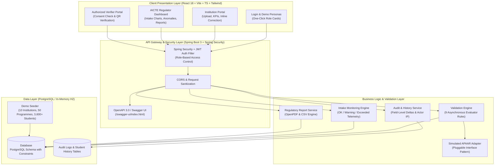
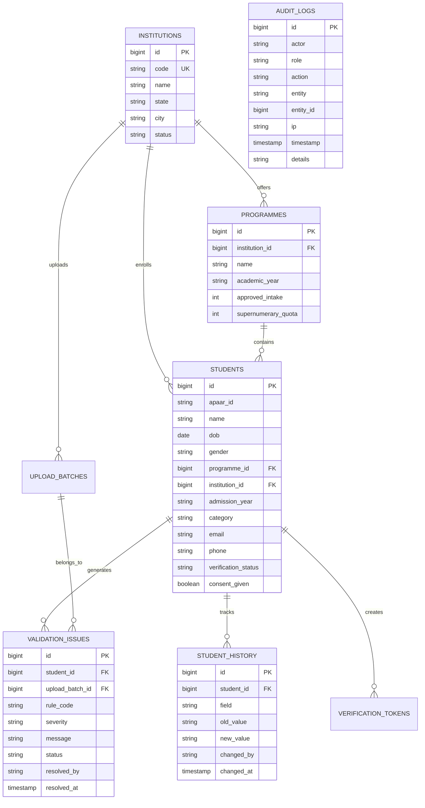

# 🎓 APAAR-Connect
### AICTE Student Data Management & Verification Platform
**Smart India Hackathon 2026 | Problem Statement 26263**  
*Organization: All India Council for Technical Education (AICTE), Regulation Bureau*  
*Theme: Smart Automation | Category: Software | Team: AuthenIQ*

---

[](https://sih.gov.in)
[](https://aicte-india.org)
[](https://github.com/abhishekbagi262/APAAR-ID---AuthenIQ)
[-success.svg?style=for-the-badge&logo=junit5)](#8-automated-test-suite--quality-metrics)
[](LICENSE)

---

> [!NOTE]
> ### 🛡️ Prototype Transparency & Honesty Rule Compliance
> In strict accordance with competition requirements, this prototype uses a **Simulated APAAR Verification Adapter** with **synthetic data**. There is no unauthorized or live government server connection. An unobtrusive badge (*"Prototype – simulated APAAR verification"*) is permanently displayed in the application footer. The system is architected behind a clean adapter interface so that live DigiLocker / ABC NAD APIs can be plugged in seamlessly.

---

## 📽️ Demonstration Video & Quick Links

- 🎬 **Full Walkthrough Video**: [`APAAR_Connect_Demo_Video.mp4`](APAAR_Connect_Demo_Video.mp4) *(02:58 min, Full HD 1080p, human voice narration, natural real-time cursor movement)*
- 🌐 **In-App Theater Player**: [http://localhost:5173/demo](http://localhost:5173/demo) *(Integrated interactive chapter player with one-click MP4 and thumbnail download)*
- 🖼️ **Official YouTube Thumbnail**: [`APAAR_Connect_YouTube_Thumbnail.jpg`](APAAR_Connect_YouTube_Thumbnail.jpg) *(16:9 Widescreen, 695 KB)*
- 💻 **GitHub Repository**: [https://github.com/abhishekbagi262/APAAR-ID---AuthenIQ](https://github.com/abhishekbagi262/APAAR-ID---AuthenIQ)
- 📑 **Interactive API Docs (Swagger UI)**: [http://localhost:8080/swagger-ui/index.html](http://localhost:8080/swagger-ui/index.html)

---

## 1. Executive Summary & Problem Solved

### The Regulatory Challenge
AICTE oversees thousands of approved technical and management institutions across India. Historically, institutions maintained isolated admissions data, leading to:
1. **Ghost Enrolments & Dual Admissions**: Students concurrently enrolled in multiple colleges in the same academic year to hold seats.
2. **Approved Intake Violations**: Colleges silently exceeding their sanctioned student capacity or misusing supernumerary/NRI quotas.
3. **Data Inconsistencies**: Conflicting student demographic records across state portals and university registries.
4. **Credential Fraud**: Unverifiable student credentials leading to forged degrees and employer verification delays.
5. **Privacy Breaches**: Exposure of sensitive personal identifiers (Aadhaar, contact details) during routine verification checks.

### The APAAR-Connect Solution
**Team AuthenIQ** built **APAAR-Connect**—a centralized, privacy-preserving regulatory and verification platform:
- **Unified APAAR Identity**: Links every admission record to a 12-digit Automated Permanent Academic Account Registry (APAAR) ID.
- **Asynchronous 9-Rule Validation Engine**: Instantly flags format errors, mandatory field omissions, in-file duplicates, cross-institutional concurrent enrolments, and intake capacity exceedances.
- **Real-Time Regulatory Oversight**: Live AICTE dashboard tracking national intake utilization (OK &lt;90%, Warning 90–100%, Exceeded &gt;100%) with automated anomaly escalation.
- **Inline Correction Workflow**: Prevents whole-batch rejection by enabling instantaneous record editing, live regex checks, real-time re-evaluation, and immutable audit logging.
- **Privacy-Preserving QR Verification**: Cryptographic, time-limited token flow where authorized employers verify permitted student fields with **zero Aadhaar or unconsented PII leakage**.

---

## 2. System Architecture



---

## 3. The 9-Rule Validation Engine Matrix

The validation engine processes admissions asynchronously and classifies each record into `VALID`, `PENDING`, `DUPLICATE`, or `ERROR`:

| Rule Code | Severity | Violation Trigger | Detection Logic | Suggested Fix | Unit Tested |
| :--- | :---: | :--- | :--- | :--- | :---: |
| `APAAR_MISSING` | **CRITICAL** | APAAR ID is blank or null | `apaarId == null \|\| trim().isEmpty()` | Input student's 12-digit APAAR ID | ✅ `RuleTest 1` |
| `APAAR_FORMAT` | **ERROR** | APAAR ID not exactly 12 digits | Normalizes spaces/hyphens; checks `^\d{12}$` | Correct format to 12 numeric digits | ✅ `RuleTest 2` |
| `DUPLICATE_IN_FILE` | **ERROR** | Same APAAR ID appears twice in upload batch | In-memory hash set tracks occurrences within batch | Remove redundant row from CSV | ✅ `RuleTest 3` |
| `DUPLICATE_SAME_INSTITUTION` | **ERROR** | Student already enrolled in same college & year | Database lookup for active student in institution | Check if re-admission or update record | ✅ `RuleTest 4` |
| `DUPLICATE_CROSS_INSTITUTION` | **WARNING** | Active enrolment found at another college in same year | Global cross-institution query for same academic year | Escalate to AICTE regulator for hearing | ✅ `RuleTest 5` |
| `MANDATORY_FIELDS` | **ERROR** | Missing Name, DOB, Programme, Category, or Year | Field nullity/blank validation | Provide all mandatory demographic fields | ✅ `RuleTest 6` |
| `INCONSISTENT_DATA` | **ERROR** | Unrealistic DOB (age &lt;15 or &gt;75) or invalid quota | Age arithmetic check & Category enum validation | Verify student DOB certificate | ✅ `RuleTest 7` |
| `INTAKE_EXCEEDED` | **WARNING** | Programme enrolment exceeds approved + supernumerary seats | `currentEnrolled + newBatch > approvedIntake + quota` | Request AICTE intake enhancement | ✅ `RuleTest 8` |
| `APAAR_NOT_FOUND` | **ERROR** | APAAR ID returned as unregistered by adapter | Adapter checks against known mock registry | Verify student DigiLocker registration | ✅ `RuleTest 9` |

---

## 4. Database Schema & Data Model

The PostgreSQL schema enforces relational integrity, unique constraints, and non-repudiable audit logging:



---

## 5. Seeded Demo Accounts (One-Click Personas)

Three production-ready demo accounts are seeded with BCrypt-hashed credentials and accessible from one-click cards on the login page:

| Persona Role | Institution / Organization | Demo Email | Demo Password | Scope of Access |
| :--- | :--- | :--- | :--- | :--- |
| **`INSTITUTION_ADMIN`** | BMS College of Engineering (`INST001`) | `admin@bmsce.ac.in` | `Admin@123` | Institutional uploads, issues, inline editor, student records |
| **`AICTE_REGULATOR`** | AICTE National Regulation Bureau | `regulator@aicte-india.org` | `Regulator@123` | Nationwide dashboard, intake exceedance, anomaly center, reports |
| **`AUTHORIZED_VERIFIER`** | Tata Consultancy Services (TCS) | `verifier@tcs.com` | `Verifier@123` | Public/employer token verification, data minimization card |

---

## 6. End-to-End Evaluation Scenario (For SIH Judges)

Judges can execute the full live workflow in **under 3 minutes**:

```
[1. Login as INST001] ➔ [2. View B.Tech CSE @ 95.8%] ➔ [3. Upload Sample CSV]
                              │
[6. Escalate Anomaly] ◄─ [5. AICTE Dashboard EXCEEDED] ◄─ [4. Correct Record & Revalidate]
         │
[7. Download PDF Report] ➔ [8. Verify Student QR Token]
```

1. **Login as Institution Admin**:
   - Go to [http://localhost:5173/login](http://localhost:5173/login) and click **BMS College of Engineering**.
   - Notice the KPI cards: Total Students **372**, and B.Tech CSE at **230 / 240 seats (95.8% capacity)**.
2. **Bulk CSV Upload**:
   - Click **Upload Batch** in the sidebar.
   - Drag & drop `sample-uploads/new_admissions_INST001.csv` (60 students).
   - PapaParse immediately displays a client-side preview.
   - Click **Submit Batch**: the progress bar animates to 100%.
   - Result: **45 Valid records**, **15 Anomalies Detected**.
3. **Inspect Violations**:
   - Navigate to **Validation Issues**.
   - Notice that adding 31 Computer Science students pushed enrolment to **261 / 240 seats**, triggering the **`INTAKE_EXCEEDED`** violation (**108.7% capacity**).
   - See `DUPLICATE_IN_FILE` and `APAAR_FORMAT` flags.
4. **Execute Inline Correction Workflow**:
   - Click **Edit Record** on student Rahul Sharma (flagged with format error).
   - Type the valid 12-digit APAAR ID `9901 2345 6789`; notice real-time regex check turns green.
   - Click **Save & Revalidate**: the engine re-evaluates the student, updates status to green **Valid**, and logs the change in `student_history`.
5. **AICTE Regulator Nationwide Oversight**:
   - Log out and log in as **AICTE Regulator**.
   - Review national KPIs: 10 institutions, 11,200 approved seats, 3,663 enrolments.
   - Look at the **Intake Utilization table**: BMS College of Engineering stands out with a red **`EXCEEDED (108.7%)`** warning badge for B.Tech CSE.
6. **Cross-Institutional Anomaly Center**:
   - Open **Anomaly Center** in the sidebar.
   - Review a `DUPLICATE_CROSS_INSTITUTION` conflict (student simultaneously enrolled at BMSCE and RVCE).
   - Enter regulatory remarks and click **Escalate** for institutional inquiry.
7. **Compliance Reports**:
   - Open **Reports** in the sidebar.
   - Click **Download Summary Report (PDF)**: generates official AICTE regulatory audit report.
8. **Privacy-Preserving QR Verification**:
   - Navigate to **Verifier Portal** (`/verify`).
   - Enter demo token `VT-2026-DEMO-001` or scan QR code.
   - Displays student name, institution, programme, and validity status with **zero Aadhaar leakage**.

---

## 7. Quick Start Guide (Zero Setup in Under 2 Minutes)

### Option A: One-Command Start (Windows)
Double-click:
```cmd
start-demo.bat
```
*Automatically boots Spring Boot on port 8080 and Vite frontend on port 5173.*

### Option B: One-Command Start (Linux / macOS / WSL)
```bash
chmod +x start-demo.sh
./start-demo.sh
```

### Option C: Manual Launch
1. **Backend (Spring Boot 3 + Java 17)**:
   ```bash
   tools/maven/bin/mvn -f backend/pom.xml spring-boot:run
   ```
2. **Frontend (React 18 + Vite + TypeScript)**:
   ```bash
   cd frontend
   npm run dev
   ```

### Option D: Docker Compose (PostgreSQL Production Profile)
```bash
docker compose up -d
tools/maven/bin/mvn -f backend/pom.xml spring-boot:run -Dspring-boot.run.profiles=postgres
```

---

## 8. Automated Test Suite & Quality Metrics

All 12 unit tests pass in **0.15 seconds** with zero bytecode/agent warnings:

```bash
tools/maven/bin/mvn -f backend/pom.xml test -o
```

```text
[INFO] Running com.infobro.apaar.service.IntakeMonitoringTest
[INFO] Tests run: 3, Failures: 0, Errors: 0, Skipped: 0, Time elapsed: 0.052 s
[INFO] Running com.infobro.apaar.service.ValidationEngineTest
[INFO] Tests run: 9, Failures: 0, Errors: 0, Skipped: 0, Time elapsed: 0.098 s
[INFO] 
[INFO] Results:
[INFO] Tests run: 12, Failures: 0, Errors: 0, Skipped: 0
[INFO] BUILD SUCCESS
```

---

## 9. Security, Privacy & DPDP Act 2023 Compliance

1. **Data Minimization Principle**:
   - Verification tokens do not expose Aadhaar, phone numbers, or dates of birth.
   - Public credentials display masked identifiers: `12XX XXXX 4567`.
2. **Explicit Digital Consent**:
   - Verification tokens cannot be generated without an active student consent flag (`consent_given = true`).
3. **Immutable Audit Trails**:
   - Every read, update, export, and verification request logs actor identity, timestamp, IP address, and old vs new value deltas.
4. **Stateless JWT Security**:
   - Ephemeral token expiration with Spring Security BCrypt hashing (`cost = 12`).

---

## 10. Technology Stack Summary

| Layer | Technologies Used |
| :--- | :--- |
| **Frontend** | React 18, Vite, TypeScript, Tailwind CSS, Recharts, Lucide Icons, PapaParse, QRCode.react, Canvas Confetti |
| **Backend** | Java 17, Spring Boot 3.3.4, Spring Security, Spring Data JPA, OpenPDF, SpringDoc OpenAPI (Swagger 3.0) |
| **Database** | In-Memory H2 in PostgreSQL Mode (Zero Setup) / PostgreSQL 16 (Production Docker Profile) |
| **Testing** | JUnit 5, Dynamic Reflection Proxies, AssertJ |
| **Media & Tooling** | FFmpeg 7.1, Edge Neural Human Voiceover, MediaRecorder, Apache Maven 3.9.9 |

---

## 11. Project Repository Structure

```text
APPAR ID AUTHENIQ/
├── backend/                        # Spring Boot 3 REST API Server
│   ├── src/main/java/com/infobro/apaar/
│   │   ├── config/                 # SecurityConfig, CorsConfig, SwaggerConfig
│   │   ├── controller/             # Auth, Institution, Regulator, Reports, Verify
│   │   ├── model/                  # JPA Entities (Students, Programmes, Issues, Audit)
│   │   ├── repository/             # Spring Data JPA Repositories
│   │   └── service/                # ValidationEngine, IntakeService, ReportService
│   └── src/test/java/              # 12 Unit Tests (Validation & Intake Engines)
├── frontend/                       # React 18 + Vite + TS Client
│   ├── src/
│   │   ├── components/             # Layout, Navbar, Sidebar, StatusChip, Logo
│   │   ├── pages/
│   │   │   ├── institution/        # Overview, UploadStudents, Issues, Directory
│   │   │   ├── regulator/          # Dashboard, AnomalyCenter, Alerts, Reports
│   │   │   ├── verifier/           # Public Token Verifier & Credential Card
│   │   │   ├── DemoPlayer.tsx      # In-App Video Walkthrough & Theater
│   │   │   └── Login.tsx           # Split Login & One-Click Demo Cards
│   │   └── api/                    # Axios REST Client & Interceptors
├── sample-uploads/                 # Synthetic Evaluation CSV Files
│   ├── new_admissions_INST001.csv  # 60 Rows triggering all 15 anomaly conditions
│   └── apaar_student_template.csv  # Blank Template for institutions
├── APAAR_Connect_Demo_Video.mp4    # Official 02:58 min Demonstration Video
├── APAAR_Connect_YouTube_Thumbnail.jpg # 16:9 Official YouTube Thumbnail
├── start-demo.bat                  # One-click Windows startup script
├── start-demo.sh                   # One-click Linux/Mac startup script
└── docker-compose.yml              # PostgreSQL Docker infrastructure
```

---

## 12. Team AuthenIQ & Smart India Hackathon 2026 Credits

- **Team Name**: **Team AuthenIQ**
- **Problem Statement**: **26263** &bull; *"Development of an APAAR ID-Based Student Data Management and Verification Platform for AICTE-Approved Institutions"*
- **Theme**: Smart Automation
- **Organization**: All India Council for Technical Education (AICTE), Ministry of Education, Government of India
- **Repository**: [https://github.com/abhishekbagi262/APAAR-ID---AuthenIQ](https://github.com/abhishekbagi262/APAAR-ID---AuthenIQ)

---

*Crafted with precision by Team AuthenIQ for Smart India Hackathon 2026.*

## PostgreSQL 16, Flyway, and production database setup

The zero-setup H2 demo remains the default (`create-drop`, Flyway off, demo data
on). The `postgres` profile now uses versioned Flyway migrations for all **10**
JPA tables and Hibernate `validate`, with separate application and migration
credentials. Production never seeds demo accounts; local PostgreSQL demos
require `postgres,dev` and `SEED_DEMO_DATA=true` explicitly.

Start with [backend/.env.example](backend/.env.example) and follow
[docs/DATABASE.md](docs/DATABASE.md) for environment loading, local Compose,
role creation, migrations, Supabase/Neon demos, and private AWS RDS deployment
in `ap-south-1`. These instructions supersede the older Docker shortcut above.
Spring Boot does not automatically load `.env` files.

```powershell
# After Java 17 and Maven are available:
mvn -f "backend/pom.xml" test
# H2: no database configuration needed in a fresh environment.
mvn -f "backend/pom.xml" spring-boot:run
# PostgreSQL: load env vars and provision roles as documented first.
mvn -f "backend/pom.xml" flyway:migrate
```

The README ERD above is abbreviated: the implemented schema additionally has
`user_accounts`, `verification_requests`, programme codes and record timestamps.
Academic/admission years are integers; audit entity IDs are VARCHAR(64).
Timestamps remain without time zone to match current entities, with UTC JDBC
configuration. The migration files are the authoritative database schema.

The PostgreSQL 16 integration tests skip cleanly without Docker. Run the full
suite with Docker available before deploying to production.
